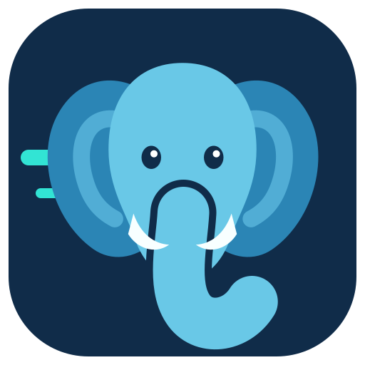

# Penthario

**The Master of Transactions**

A native alternative to pgAdmin 4 for everyday PostgreSQL work. Formerly known
as pgadmin-jr (pgadmin junior), Penthario is an independent open-source project
focused on the PostgreSQL tasks you use most often.

[Project homepage](https://hdijkema.github.io/penthario/)

Penthario brings SQL editing, database browsing, result export and administration
into a C++17/FLTK application. Connect to a server, choose a database and work
in independent query tabs, each with its own session and transaction.

## Why it exists

The project began with a practical frustration: waiting minutes for pgAdmin 4 to
start before being able to run a query. Its goal is a responsive, focused desktop
tool that starts without a local web server or an embedded browser.

The focus is the work used most often: writing SQL, inspecting database objects,
working with results, managing permissions and maintaining databases. Monitoring,
replication management, ER diagrams and a procedural debugger are outside the
current scope. Startup speed and responsiveness guide the design; performance
still depends on the machine, server and query being executed.

## What you can do

- **Connect and browse.** Save server profiles, optionally remember passwords in
  the operating system's credential vault, and browse databases, schemas, tables,
  views, materialized views, sequences, foreign tables and columns. Functions,
  procedures and trigger functions have their own groups, with signatures for
  overloads. Inspect object properties and definition SQL.
- **Work in SQL.** Use syntax highlighting, search/replace, completion, query
  history and a named query library with categories. Run a selection or a whole
  script. Independent tabs keep temporary tables and transactions separate.
- **Keep your workspace.** Open tabs, unsaved SQL, database targets, cursor positions
  and column widths are restored after a normal exit. Give tabs your own names.
  Connecting a server profile reconnects its restored tabs to their databases,
  without executing the saved SQL.
- **Use the results.** View multiple statement results in one continuous overview,
  optionally label sections, inspect large text/binary cells and copy results to
  the clipboard. Export CSV or XLSX, including execution directly to a file for
  results larger than the bounded preview.
- **Inspect execution plans.** Run EXPLAIN from the plan tab with selectable options
  and TEXT, JSON, XML or YAML output. ANALYZE can collect real execution statistics;
  plan-mode database changes are rolled back afterwards. Existing transactions
  are protected with a savepoint. Sequence values and external effects may persist.
- **Administer databases.** Back up and restore databases, create/drop databases,
  manage server roles and database privileges, and run VACUUM, ANALYZE or REINDEX.

The interface is available in **Dutch, English and German**. PostgreSQL operations
use the connected role's privileges; the application does not bypass server permissions.

## Get started

Download the package for your system from [GitHub Releases](https://github.com/hdijkema/penthario/releases).
Release builds provide a Windows installer and portable ZIP, an Apple Silicon macOS
DMG, Debian 12/13 packages for amd64 and ARM64, and an x86_64 Flatpak bundle.
ARM64 Debian packages require a 64-bit OS with matching dependencies, including
on Raspberry Pi. macOS signing/notarisation and platform validation limits are
described in the packaging documentation below.

The macOS build has been reported working out of the box on a MacBook Air M1.
See the [validation report](docs/VALIDATION.md) for the scope of platform checks.

1. Start the application and create a connection profile with your server, port
   and PostgreSQL user. Usually use `postgres` as the maintenance database.
2. Connect the profile, then expand **Databases** in the browser.
3. Right-click the database you want and open a query tab.
4. Write SQL and press **F5**. Selected text runs by itself; otherwise the script runs.
5. Use the results, messages and execution-plan tabs below the editor.

Connecting a maintenance database does not restrict query tabs to that database.
Each tab shows its own target. Double-click a tab, or use its context menu, to
rename it; leaving the name empty restores the default title.

## Documentation and development

The default application uses **FLTK**, **fltk-css** and **fltk-cell**, with STL
values and libpq worker sessions.
See [FLTK implementation](docs/FLTK.md) for limits and migration details.

- [User and build guide](docs/USER-GUIDE.md): detailed usage, shortcuts, settings,
  dependencies, local builds and tests.
- [Validation report](docs/VALIDATION.md): local checks and platform limits.
- [Release notes](RELEASE-NOTES.md): highlights of version 0.4.4.
- [Development guide](docs/DEVELOPMENT.md): component responsibilities, sessions
  and data flow.
- [Source layout](docs/SOURCE-LAYOUT.md): where the application code lives.
- [GitHub Actions and releases](docs/CI.md): build workflows, versions and assets.
- [Linux packaging](docs/LINUX-PACKAGING.md) and [macOS packaging](docs/MACOS-PACKAGING.md):
  installation, runtime dependencies and validation/signing limits.

Build the root `CMakeLists.txt` with CMake and a C++17 compiler. Windows is
the local validation baseline; the hosted workflows build the other platforms.
Documentation and source comments are written in English.

Dependency versions are selected by release tags. The widget libraries
`fltk-css` and `fltk-toolbar` are selected at **v0.1.1**; `fltk-cell` and
`fltk-dock` are selected at **v0.1.0**.
Local development can use explicit sibling source paths instead. See
[dependencies and release order](docs/DEPENDENCIES.md).

See [LICENSE](LICENSE) for the project licence. Third-party icon and library
licence notices are included with the source and distribution packages.

Appearance can be changed under **View > Theme**. Built-in Light, Dark and
Classic themes support local CSS overrides; see [themes](docs/THEMES.md).
